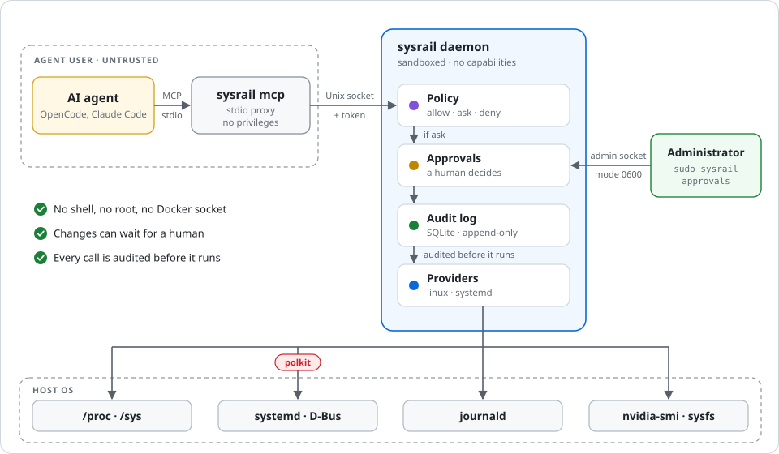

# Security model

SysRail lets AI agents inspect and manage a Linux host through a fixed set of
typed operations. Its job is to make sure an agent can do only what the policy
allows, that sensitive changes wait for a human, and that everything is
recorded. This holds regardless of what the model decides to do.

This document describes what SysRail trusts, how it enforces its boundaries,
and, just as important, what it does not protect against. To report a
vulnerability, see [SECURITY.md](../SECURITY.md).

## Trust assumptions

The model is not trusted. Agents may be wrong, may be manipulated by prompt
injection hidden in logs or files they read, and may try to do more than they
were asked to.

| Trusted | Untrusted |
|---|---|
| The SysRail daemon and its providers | The model and its reasoning |
| The policy, configuration and polkit rule written by the administrator | Prompts and any content the agent reads, including service logs |
| The administrator using the admin socket | Tool arguments, until they pass validation |
| The host OS: root, systemd, polkit, journald | The "reason" an agent gives for a request |
| | `sysrail mcp` and everything else running as the agent's OS user |

## How the boundaries are enforced

Each call passes through several independent layers. No single layer is
meant to be sufficient on its own.

1. **Authentication.** Every agent has its own token. Only SHA-256 hashes are
   stored, and tokens are compared in constant time. The agent socket is also
   restricted to the `sysrail-agents` group. `sysrail mcp` holds no privileges;
   it is just a client of the daemon.
2. **A fixed list of operations.** Agents can only call registered
   capabilities. There is no shell, no generic command tool, and no access to
   arbitrary files or the Docker socket. The registry refuses to load
   capabilities with generic names such as `exec`, `run` or `shell`.
3. **Input validation.** Arguments are checked against a JSON schema, decoded
   strictly (unknown fields are errors), and then validated semantically.
   Service names must be valid `.service` unit names that cannot be read as
   options. The helpers SysRail runs (`journalctl`, `nvidia-smi`) get fixed
   argument lists and a fixed environment; no shell is ever involved.
4. **Policy.** Every call is checked against the policy: allow, ask or deny,
   per agent and optionally per service. Anything not explicitly granted is
   denied, and any matching deny wins. An invalid policy (unknown permission,
   agent or key) is never loaded.
5. **Hard limits.** Some units can never be changed, whatever the policy
   says: `sysrail.service` always, and dbus, `systemd-*`, polkit, ssh,
   `user@*` and `getty@*` by default.
6. **Human approval.** For `ask`, nothing runs until an administrator
   approves on the server through the admin socket. That socket is mode 0600
   and owned by the daemon user, so an agent can't approve its own request.
   The approver's UID is taken from the socket's peer credentials. On
   approval, the daemon re-validates the stored arguments, checks that they
   hash to what the agent originally sent, re-checks the policy, and only then
   runs the request, exactly once. Pending requests expire.
7. **OS authorization.** The daemon runs as the unprivileged `sysrail` user
   with no capabilities. Service changes go through systemd over D-Bus, and
   polkit decides which units that user may touch. A policy mistake alone
   therefore can't reach units outside the polkit rule.
8. **Sandboxing.** The systemd unit makes the system read-only to the daemon,
   gives it private `/tmp`, applies a system-call allow-list, denies new
   privileges, and restricts namespaces, address families and kernel
   tunables.
9. **Limits.** Every operation has a timeout. Request bodies are limited to
   1 MiB, log output to 256 KiB, and list results to fixed maximums.
10. **Audit.** Every call is written to the audit log before anything runs,
    including reads, refusals and invalid calls. If the record cannot be
    written, the call is refused. The audit table rejects updates. Deletes
    happen only through retention, which writes the records to an archive
    first and then logs a `retention` record of what it removed.
11. **Redaction.** Before results, logs and audited arguments leave the
    daemon, SysRail masks passwords, tokens, API keys, private keys, JWTs,
    credentials in URLs and similar values.
12. **Isolation between agents.** An agent sees only its own requests, and
    only the host events about resources its policy lets it read.

## What SysRail does not protect against

**Agents with another way in.** SysRail only controls what passes through
it. An agent can bypass it entirely if its host also gives it a shell, file
write access, SSH, sudo, membership in the `docker` group, or any other path
to the system. Examples are Claude Code's or OpenCode's built-in shell tools,
running as a user with sudo rights. For SysRail to be the boundary, an agent
that uses it must have no other access to the host.

**Approvals depend on the person approving.** The "reason" shown at
approval is written by the agent. A prompt-injected agent can write a
convincing one. Judge requests by the capability, resource and impact, which
SysRail itself provides.

**Data the agent can read leaves the host.** Anything a read tool returns
goes to the agent and usually on to the model provider's API. That includes
hostnames, addresses, open ports, mount paths and service logs. Grant
`logs.read` and the other read permissions only for what you are willing to
share.

**Redaction is best-effort.** It recognizes common secret formats, not every
secret. A credential in an unusual format can pass through service logs.
Don't rely on redaction for services that log sensitive data; deny
`logs.read` for them instead.

**Root and the `sysrail` user.** Root on the host can do anything, including
editing the audit database and the retention archives, which are ordinary
files under `/var/lib/sysrail`. The append-only rule protects against
SysRail bugs, not against root. Anyone who controls the `sysrail` user can do what
the polkit rule allows. To make the audit trail tamper-evident, export it
off the host regularly (`sysrail audit --json`).

**Tokens on the agent host.** A token is readable by anything running as the
agent's OS user. If two agents with different rights run as the same OS user,
the weaker one can read the stronger one's token. Run agents with different
rights as different users.

**The network.** The HTTP API has no TLS. It listens on loopback by default;
`allow_remote` would expose tokens on the network. Use an SSH tunnel instead.
If you enable `admin.token_sha256`, whoever holds that token can approve
requests over HTTP, so keep it away from anything an agent can reach.

**Resource exhaustion.** There is no rate limiting. A misbehaving agent can
fill the approval queue and make the audit database grow quickly between
retention runs.

**Notifications leave the host.** Notification messages contain the host
name, agent, capability, resource and the agent's reason. They go to
whichever service you configure: ntfy, Telegram, an email provider, or a
webhook. Anyone who knows the name of a topic on the public ntfy.sh can read
it. Treat the reason in a message as untrusted text, just like at approval;
messages never approve anything themselves. Channel credentials (bot tokens,
SMTP passwords) are stored in `config.yaml`, readable by root and the
`sysrail` group.

**Configuration.** The protection is only as narrow as your policy, polkit
rule and protected-unit list. A restart that SysRail allows can still harm a
service that should not be restarted at that moment, for example a database
in the middle of a migration.

**Changes cannot be stopped once they start.** An approved or allowed change
runs to completion within its timeout, even if the agent disconnects.

## Hardening checklist

- Run each agent as a dedicated OS user without sudo, without the `docker`
  group, and with its host's built-in shell and file-write tools disabled.
- Give each agent its own token. Store it in a file with mode 0600 and use
  `--token-file`.
- Start from a read-only policy. Prefer `ask` for every change and use
  `allow` only for specific services.
- Keep the polkit rule as narrow as the policy, and list services explicitly.
- Deny `logs.read` for services whose logs contain secrets or personal data.
- Keep the HTTP API on loopback. Use SSH to reach it from elsewhere.
- Configure notifications, so requests are seen before they expire. Prefer a
  self-hosted ntfy or another private channel. Review the audit log
  regularly.
- Copy audit exports and retention archives off the host if you need a trail
  that root on the server cannot alter.
- Keep SysRail up to date. The build pins a patched Go toolchain, and
  dependencies are checked with govulncheck (`make vulncheck`).
